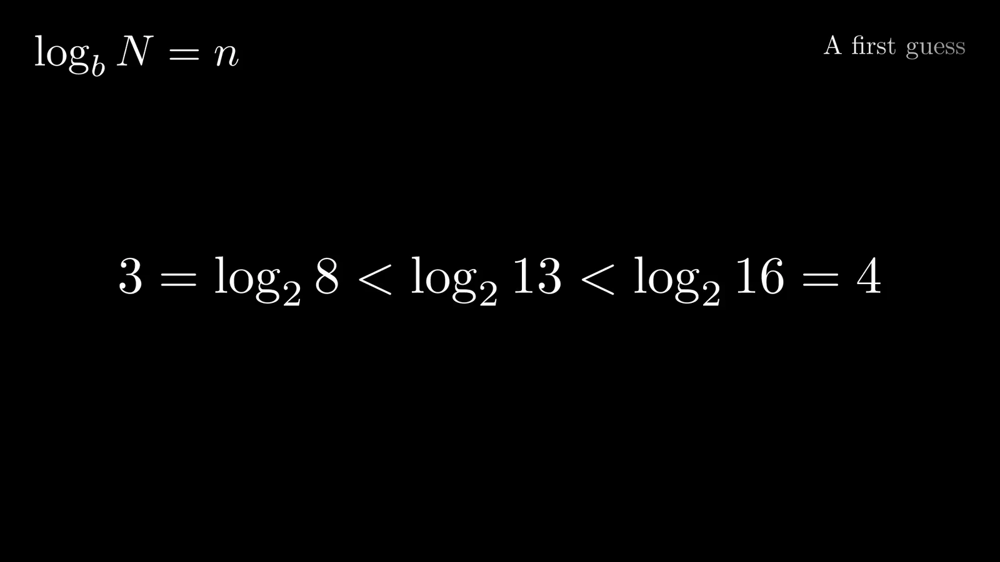
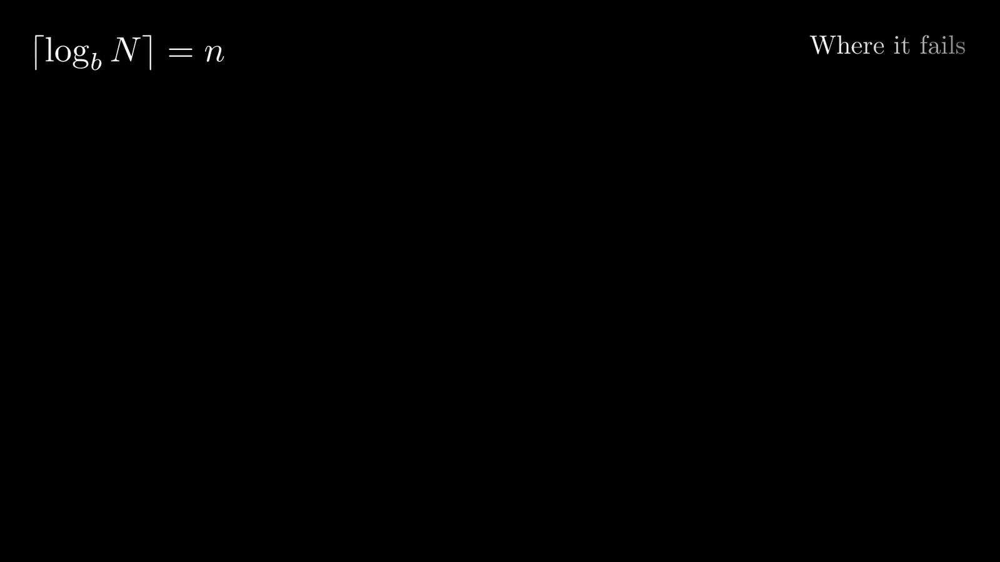
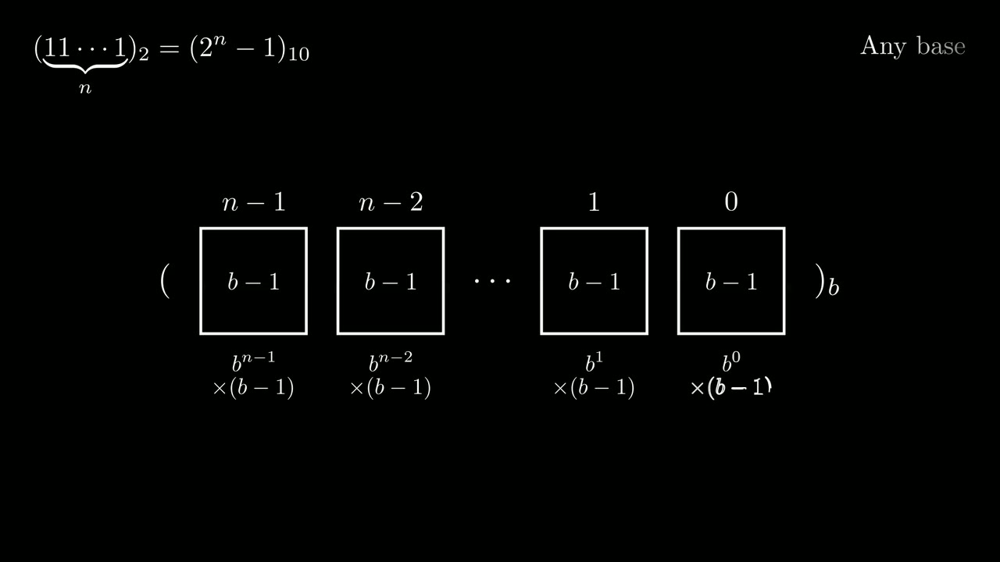
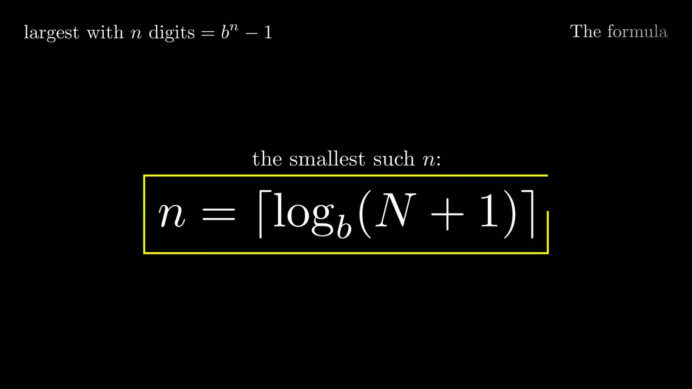
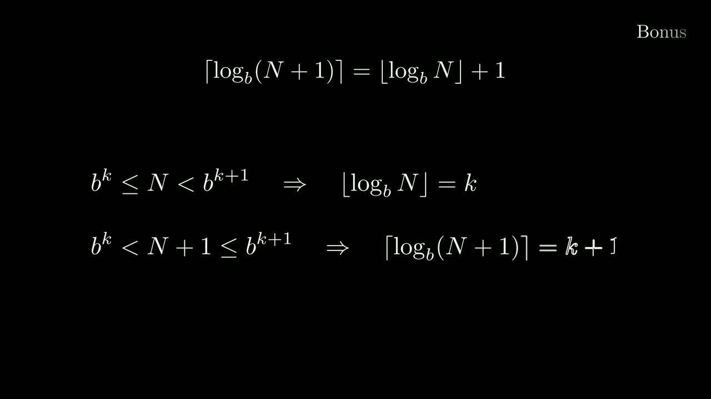

<div align="center">

# How many bits?

**The digits a number needs, in any base.** An animated presentation, made with Manim.

[**Step through the slides**](https://ausdavoud.github.io/How-Many-Bits-Manim/slides.html)&nbsp;&nbsp;·&nbsp;&nbsp;[Watch it as one video](https://ausdavoud.github.io/How-Many-Bits-Manim/how-many-bits.mp4)&nbsp;&nbsp;·&nbsp;&nbsp;[Website](https://ausdavoud.github.io/How-Many-Bits-Manim/)

<br>



</div>

To write 13 in binary you need four bits, and ⌈log₂ 13⌉ is 4. That rule of thumb works until you try 8, which also needs four bits while ⌈log₂ 8⌉ is 3. These slides work out why, and arrive at a formula that holds in every base: **n = ⌈log<sub>b</sub>(N + 1)⌉**.

## What it covers

1. **The question.** How many digits does a decimal number need in base b? 7 is `111` in binary: three.
2. **A first guess.** log₂ 13 ≈ 3.7, and there's no such thing as 0.7 of a bit, so round up to 4.
3. **Where it fails.** 2, 8 and 81 each need one digit more than the guess says. All three are powers of their base.
4. **The largest number.** n ones in binary add up to 2ⁿ − 1.
5. **Any base.** n digits of b − 1 add up to bⁿ − 1, by a geometric series.
6. **The formula.** N has to fit in n digits, so N ≤ bⁿ − 1, which gives n = ⌈log<sub>b</sub>(N + 1)⌉.
7. **Bonus.** The same count is also ⌊log<sub>b</sub> N⌋ + 1.
8. **Answers.** Back to the three questions the failures raised.

<p align="center">
  
</p>

<p align="center">
  
  
  
</p>

## From the notebook

This began as a Google Colab notebook, kept as it was in [`notebook/`](notebook/colab-original.ipynb). Bringing it here, I split it into one scene per chapter and fixed two slips in the maths: the formula read log<sub>b</sub> N + 1 where it meant log<sub>b</sub>(N + 1), and log₂ 13 is about 3.7, not 3.5. I also added a short proof of the bonus identity and the last chapter, which answers the three questions the notebook raised and left open.

## Run it yourself

You'll need [uv](https://docs.astral.sh/uv/), a LaTeX distribution, and the Cairo and Pango libraries Manim draws with ([Manim's installation guide](https://docs.manim.community/en/stable/installation.html) covers both).

```bash
uv sync
uv run ./render.sh
```

Then open `slides.html` and move through it with the arrow keys. For a quick low-quality pass, run `MANIM_FLAGS=-ql uv run ./render.sh`.

## Publishing the website

```bash
uv run ./publish.sh
```

This renders every scene, builds the site from `web/`, and pushes the result to the `gh-pages` branch, which GitHub Pages serves. Rendered videos never go into `main`, and only the files that changed get uploaded.

## License

[MIT](LICENSE)
